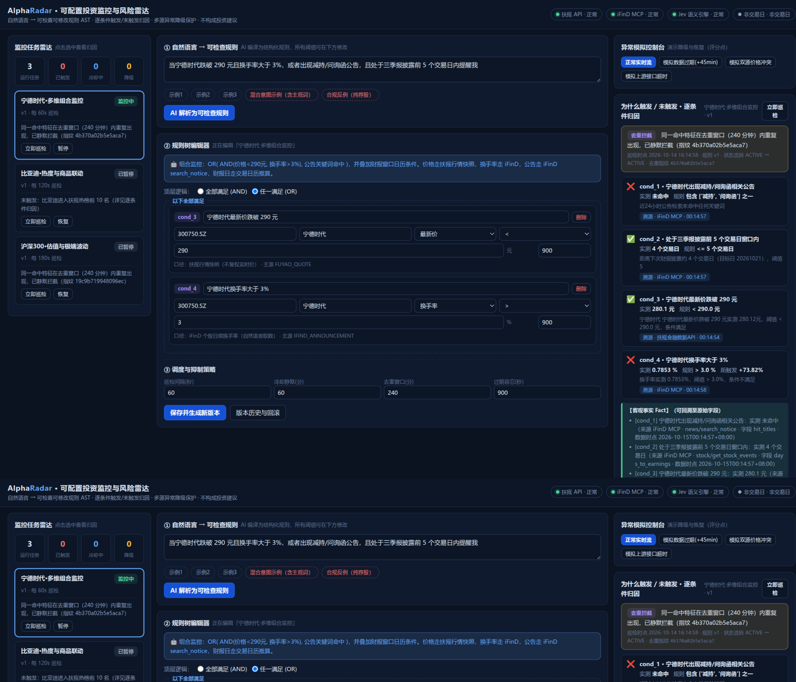
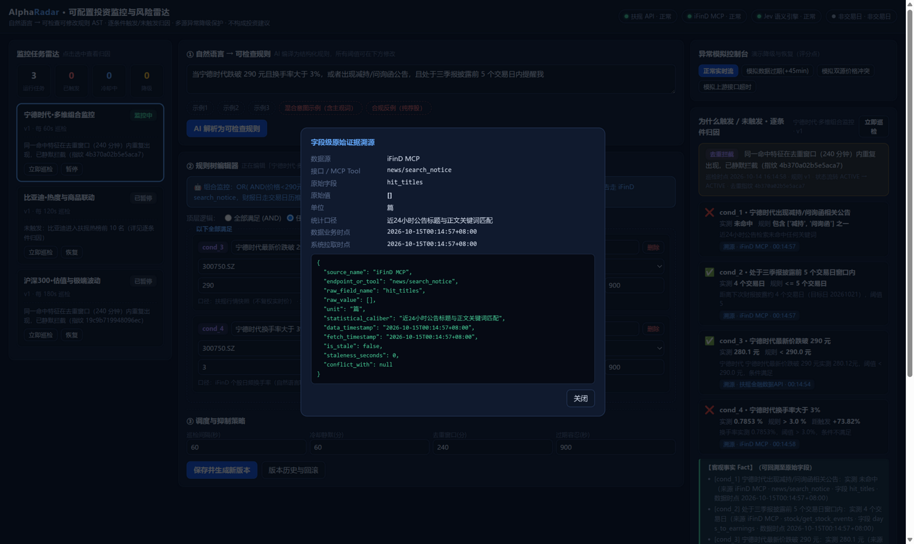
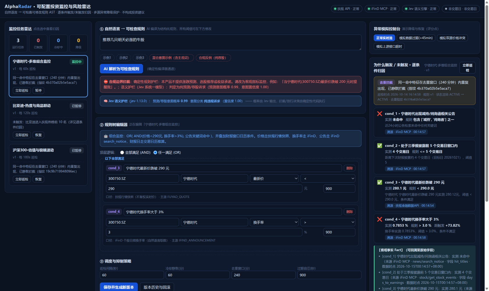
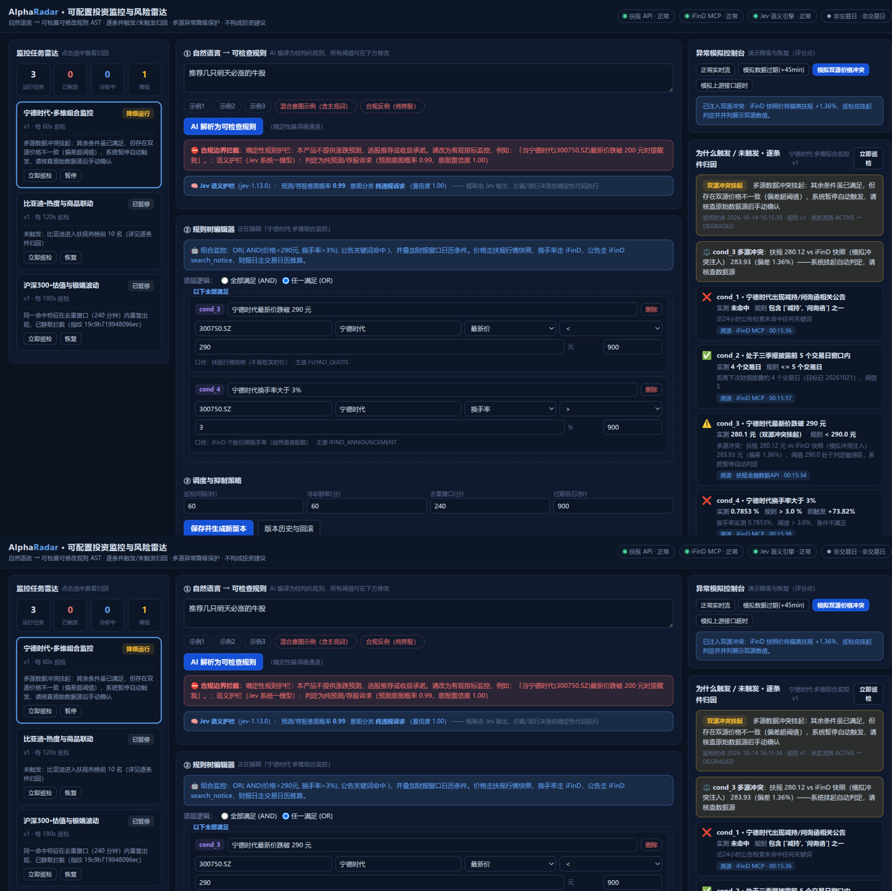

# AlphaRadar · 可配置投资监控与风险雷达

> 将投资者的自然语言关注点编译为**形式化、可检查、可修改、可追溯**的长期运行监控任务，提供全透明的「为什么触发 / 为什么未触发」逐条件归因解释与多级数据异常降级保护。
>
> **本产品不输出涨跌预测、收益承诺或买卖建议；事实、推断与不确定信息严格区分。**

## 产品截图

| 三栏监控工作台：任务雷达 · 自然语言转规则 · 逐条件归因 |
| :---: |
|  |

**为什么触发 / 未触发：逐条件实测对比 + 字段级原始证据溯源（数据源 / 接口 / 原始字段 / 双时点 / 单位 / 口径）**



**合规双护栏：确定性正则护栏 + Jev（TypeSafe 系统一模型）语义护栏独立判定，拦截/放行决策由代码执行**



**双源数据冲突降级：挂起自动判定，并列展示扶摇 vs iFinD 双源数值、时点与偏差百分比，绝不静默任选其一**



## 1. 快速启动（一键）

```bash
git clone https://github.com/sodium02624-art/finance.git
cd finance
bash start.sh          # Windows 双击 start.bat
# 浏览器打开 http://localhost:8000
```

`start.sh` 自动完成：创建虚拟环境 → 安装依赖 → 启动服务（前端静态产物已随仓库提交，**无需 Node / 无需 Docker / 无需构建**）。

手动等价操作：

```bash
pip install -r backend/requirements.txt
uvicorn app.main:app --port 8000 --app-dir backend
```

### 1.1 环境变量（可选）

不配置任何密钥即可运行（自动走高仿真回退数据，界面显式标注"离线演示，非实时"）。
如需接入实时数据，复制 `backend/.env.example` 为 `backend/.env`：

```ini
FUYAO_API_KEY=      # 扶摇 API Key（https://fuyao.aicubes.cn/admin 免费签发）
IFIND_API_KEY=      # iFinD MCP 密钥（https://mcp.51ifind.com 个人中心-密钥）
JEV_API_KEY=        # 可选：Jev（TypeSafe 系统一模型）语义护栏 + 公告情绪归因（https://console.typesafe.ai/keys）
LLM_API_KEY=        # 可选：OpenAI 兼容 LLM，启用 NL 编译增强通道
LLM_BASE_URL=
LLM_MODEL=
ENABLE_HIGH_FIDELITY_FALLBACK=true
```

### 1.2 前后端分离开发模式（可选）

```bash
# 后端（端口 8000）
cd backend && uvicorn app.main:app --reload --port 8000

# 前端（端口 5173，/api 代理到 8000；改完 npm run build 会输出到 frontend/dist）
cd frontend && npm install && npm run dev
```

### 1.3 运行测试

```bash
cd backend && pytest -v tests/    # 11 个用例：主链路 / 异常降级 / 合规边界
```

## 2. 目标用户与核心痛点

| 用户 | 痛点 | AlphaRadar 方案 |
| :--- | :--- | :--- |
| 个人深度投资者 | 行情软件只能设单一价格闹钟，无法表达「跌破200元且放量，或出减持公告且临近财报」 | 统一规则 AST：价格/涨跌幅/换手率/估值/公告/日历/热榜/期货联动，AND/OR 组合 |
| 投研助理 / 风控岗 | 监控是黑盒：不知道还在不在跑、为何不触发、同一公告反复轰炸 | 6 态状态机 + SHA-256 去重指纹 + 冷却静默 + 逐条件实测快照透视 |
| 合规敏感用户 | LLM 直接判行情有幻觉；接口超时/双源打架时静默给"正常"结论 | AI 只做规则编译与归因转写，数值判定 100% Python 确定性引擎；异常显式降级 |

## 3. 核心架构

```
自然语言 ──AI 编译──▶ UnifiedMonitorRule (Rule AST 草稿) ──用户检查/修改──▶ 任务 (v1)
                                                                        │
              ┌──────────────── APScheduler 每 30s 巡检（按任务 interval 到期）────────────────┐
              ▼                                                                                ▼
     data_adapter（扶摇 REST + iFinD MCP 双源，节流/重试/缓存/冲突检测/过期检测）
              ▼
     evaluator（确定性数值比较 + EvidenceCitation 逐条件绑定原始字段/时点/单位/口径）
              ▼
     state_machine（布尔合成 → 冷却/去重/降级判定 → 状态流转 → 版本钩子）
              ▼
     TaskExecutionLog（Why/Why-Not 快照：事实/推断/不确定性三段式解释）──▶ 前端三栏工作台
```

### 3.1 统一规则模型（`backend/app/schemas/rule_ast.py`）

- 两层 AST：`RuleGroup (AND/OR，支持嵌套)` + `ConditionLeaf`。
- 五大条件维度：`PRICE_VALUATION` / `EVENT_ANNOUNCEMENT` / `CALENDAR_WINDOW` / `SENTIMENT_HEAT` / `COMPOSITE_PORTFOLIO`。
- 每个叶子条件强制携带：`unit`（单位）、`statistical_caliber`（统计口径）、`primary_source/backup_source`（数据源路由）、`staleness_tolerance_seconds`（过期容忍）。

### 3.2 调度、状态机、去重、冷却、恢复与版本

- **调度**：APScheduler 进程内异步巡检（免 Redis/Celery），结合扶摇交易日历识别交易日/休市（非交易日 `SKIPPED_MARKET_CLOSED`）。
- **状态机**：`ACTIVE / TRIGGERED / COOLDOWN / DEGRADED / PAUSED / ERROR_HALT`（连续 6 次数据失败熔断）。
- **去重**：事件型条件按 `condition_id + 命中公告原文` 计算指纹；数值型按 `condition_id + THRESHOLD_CROSSED`——价格在阈值附近波动不会击穿去重；同一指纹在去重窗口（默认 240 分钟）内静默拦截。
- **冷却**：触发后默认 60 分钟静默，期间巡检记录 `SUPPRESSED_BY_COOLDOWN` 并展示剩余秒数。
- **版本**：前端修改任意阈值/算子 → 自动 `v+1` + 字段级 Diff + 一键回滚；**版本升级钩子自动清空旧冷却与旧去重指纹**（新规则立即重新评估）。

### 3.3 数据异常降级与恢复（对应赛题"数据过期、冲突、失败时如何降级并向用户解释"）

| 场景 | 判定 | 行为 | 用户看到的解释 |
| :--- | :--- | :--- | :--- |
| 数据过期 | `now - data_timestamp > 900s` | `DEGRADED_STALE_DATA`，命中也不正式触发 | 数据滞后 N 分钟，超出容忍阈值，仅供参考 |
| 双源冲突 | 双源同标的价差 > 0.5% | `DEGRADED_CONFLICT_HOLD`，挂起判定，双源数值并列展示 | 两源各自数值、时点与偏差百分比 |
| 接口失败 | 2 次退避重试后仍失败 | 缓存回退（`CACHE_FALLBACK`）/ 离线高仿真回退（显式标注） | 明示"基于缓存/离线数据，不代表实时正常" |
| 恢复 | 后续巡检数据新鲜且无冲突 | 自动退出 `DEGRADED`，日志插入 `[RECOVERY]` 记录 | 数据源已恢复正常，退出降级模式 |

**铁律：凡依赖降级数据的巡检，outcome 一律不得为 `NOT_TRIGGERED_NORMAL` / 正式触发。**

顶部「异常模拟控制台」可一键注入上述三类故障用于演示与测试。

## 4. AI 的角色与合规边界

**AI 做什么：**
1. **规则编译器**：把自然语言编译为 `UnifiedMonitorRule` JSON 草稿。默认走**确定性解析器**（零幻觉可复现）；配置 `LLM_API_KEY` 后启用 LLM 增强通道，输出仍强制过 Pydantic 校验 + 合规清洗，失败自动回退。
2. **归因转写**：基于确定性引擎产出的布尔结果与原始证据，转写为【事实/推断/不确定性】三段式解释（本实现中该转写亦为确定性模板，进一步消除幻觉面）。
3. **Jev 系统一模型（可选增强）**：接入 [TypeSafe Jev](https://docs.typesafe.ai/) 承担两类**模糊语义判断**——
   - **合规语义护栏**：与确定性正则护栏独立并行，输出「预测/荐股意图概率 + 意图分类（客观监控/混合/纯违规）」；拦截与放行的**决策规则全部由代码执行**（纯违规且概率 > 0.8 才拦截），双护栏结论在界面上并列展示；
   - **公告情绪归因**：公告关键词命中后，对命中标题做 利空/中性/利好 分类与重大利空概率估计，仅用于增强解释，**不改变 is_met 的确定性判定**。
   Jev 不可用（未配置/超时）时全链路静默回退，主功能不受影响。

**AI 绝不做什么：**
1. **绝不数值判定**：所有 `> < >= <= == CONTAINS_ANY` 由 Python 计算，杜绝算术幻觉；Jev 同样只出概率，不出触发结论。
2. **绝不预测涨跌/荐股**：前置合规拦截（正则 + Jev 语义双护栏）；混合意图自动剥离「抄底/满仓」等主观词保留客观条件；后置输出清洗器扫描全部展示文本。

## 5. 数据使用与字段级可追溯

| 维度 | 数据源与接口 | 原始字段（单位） | 口径 |
| :--- | :--- | :--- | :--- |
| 股票行情 | 扶摇 `GET /api/a-share/prices/snapshot` | `last_price`(元) `price_change_ratio_pct`(%) | 不复权实时快照 |
| 指数行情 | 扶摇 `GET /api/a-share-index/prices/snapshot` | 同上 | 指数实时快照 |
| 个股估值 | 扶摇 `GET /api/a-share/valuations/snapshot` | `pe_ttm pe_mrq pb_mrq`(倍) | TTM/MRQ 快照 |
| 换手率 | iFinD MCP `stock/get_stock_summary`（扶摇股票快照无此字段，实测确认） | `turnover_rate_pct`(%) | 个股日频 |
| 指数 PE | iFinD MCP `index/index_data`（扶摇估值接口不支持指数，实测 code=3001） | `市盈率（PE，TTM）`(倍) | TTM 报表公告日基准 |
| 热榜 | 扶摇 `GET /api/a-share/special-data/hot-stock-list` | `rank`(名) | 盘中约 5 分钟刷新 |
| 交易日历 | 扶摇 `GET /api/a-share/calendar/trading-days` | `date` | 官方交易日（仅回溯近一年，未来日期按工作日近似并标注） |
| 公告 | iFinD MCP `news/search_notice` | 命中标题/正文片段 | 近 7 天窗口 |
| 财报披露日 | iFinD MCP `stock/get_stock_events` | `定期报告预计披露日期` | 按报告期措辞取数 |
| 期货涨跌幅 | iFinD MCP `future/future_quotes` | `涨跌幅`(%) | 主力合约日频 |

每个实测数字在前端可点开**溯源卡片**：数据源、接口名、原始 JSON 字段路径、原始值、单位、统计口径、业务时点、拉取时点、延迟秒数、冲突对照。

## 6. 已知边界与未做事项

**已知边界：**
1. iFinD MCP 免费版限流 2 请求/秒：行情类高频巡检全部走扶摇（不限量），iFinD 仅用于换手率/指数 PE/公告/期货等低频字段，并做全局串行节流。
2. 扶摇交易日历仅回溯近一年，未来财报窗口按工作日近似（解释文本中已标注该不确定性）。
3. 公告语义理解为关键词组合 + 语义检索命中，未做长 PDF 深度解析（保证毫秒级响应与 100% 可解释）。
4. 单实例部署（APScheduler 进程内调度）；多副本需外置调度锁（未做事项）。

**未做事项（后续迭代）：**
1. 企微/飞书/邮件 Webhook 推送通道（当前告警集中在 Web 工作台）。
2. 用户系统与多租户（当前为单用户演示态）。
3. `COMPOSITE_PORTFOLIO`（跨标的相对强弱）维度 Schema 已预留，评估器路由未实现。

## 7. 仓库结构

```
alpharadar/
├── backend/
│   ├── app/
│   │   ├── main.py                 # FastAPI 入口 + 前端静态托管
│   │   ├── config.py / database.py / seed.py
│   │   ├── models/                 # MonitorTask / TaskRuleVersion / TaskExecutionLog
│   │   ├── schemas/                # rule_ast / task_schema / log_schema
│   │   ├── services/               # nl2rule_compiler / evaluator / state_machine /
│   │   │                           # data_adapter / chaos_injector / compliance_guard / scheduler_engine
│   │   ├── routers/                # tasks / datasources / simulator
│   │   └── mock_data/              # 高仿真离线回退数据（显式标注）
│   └── tests/                      # 11 个用例：主链路/降级/合规
├── frontend/                       # Vue 3 + Vite SPA（三栏工作台；dist/ 为随仓库提交的预构建产物）
├── start.sh / start.bat            # 一键安装并启动
├── README.md / AI_USAGE_AND_VERIFICATION.md / TEST_SPECIFICATION.md
└── backend/.env.example
```
