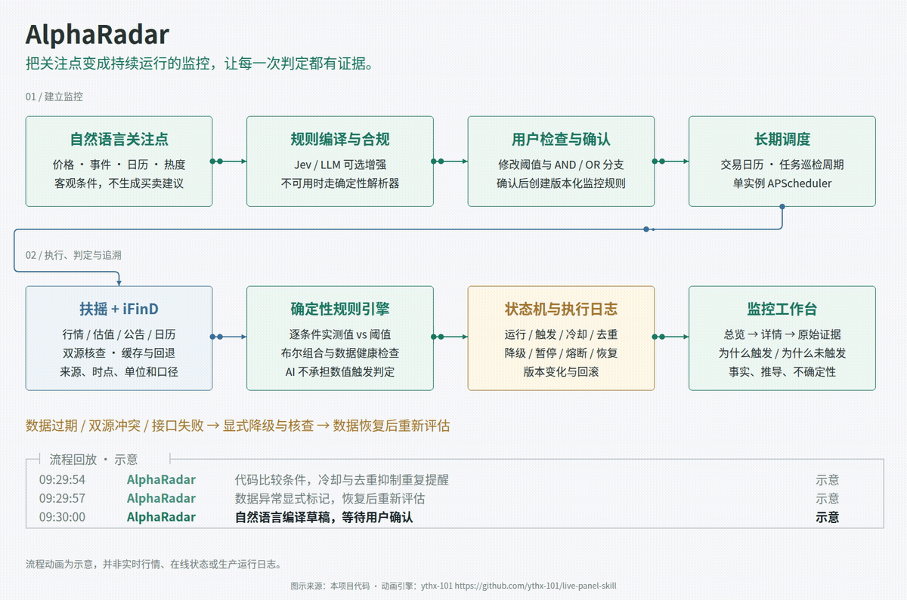
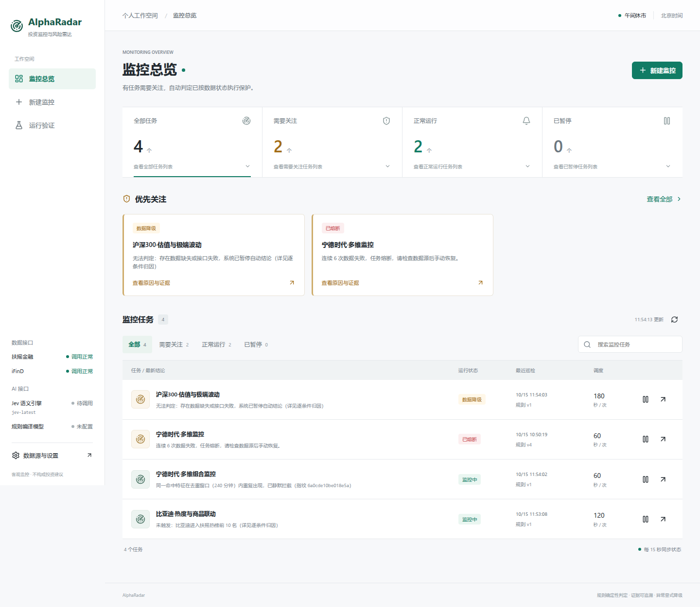
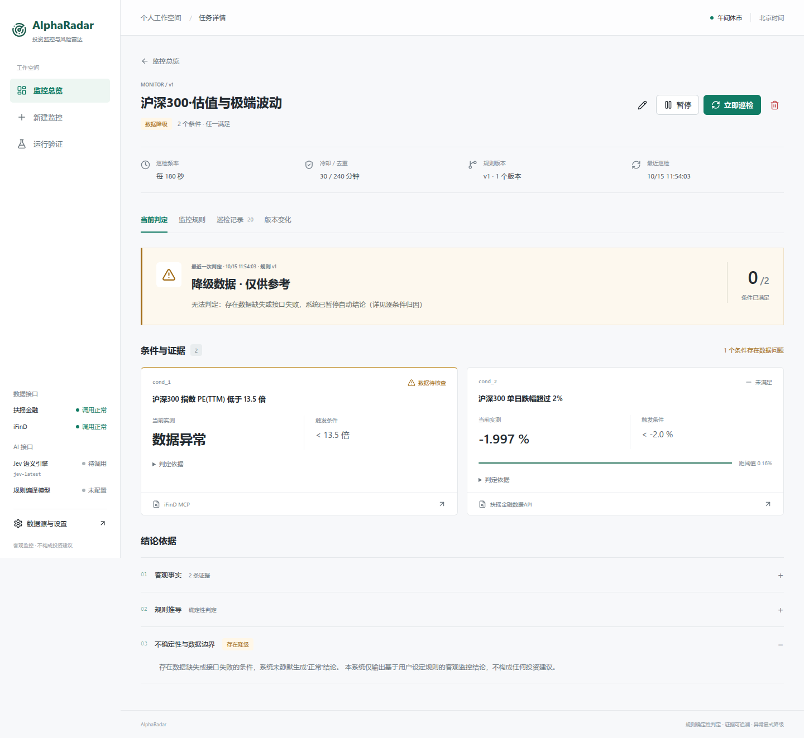
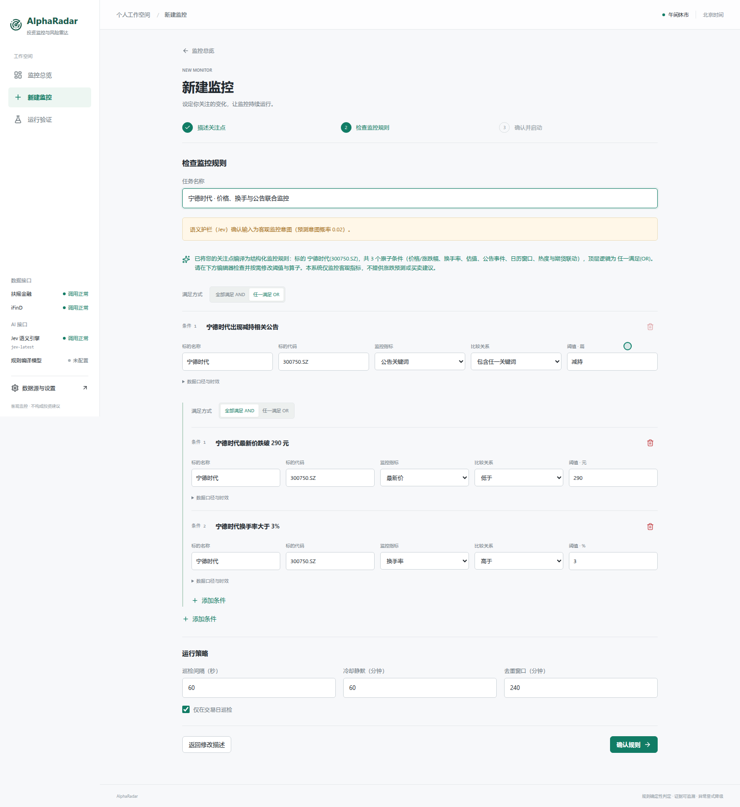
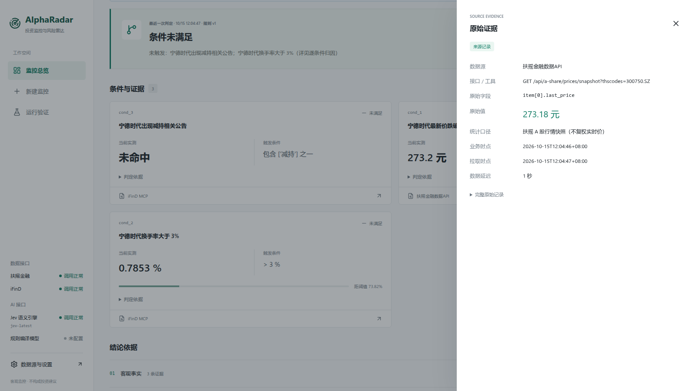
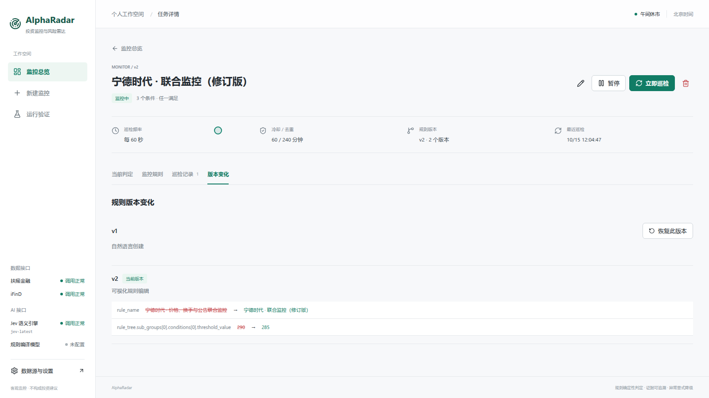
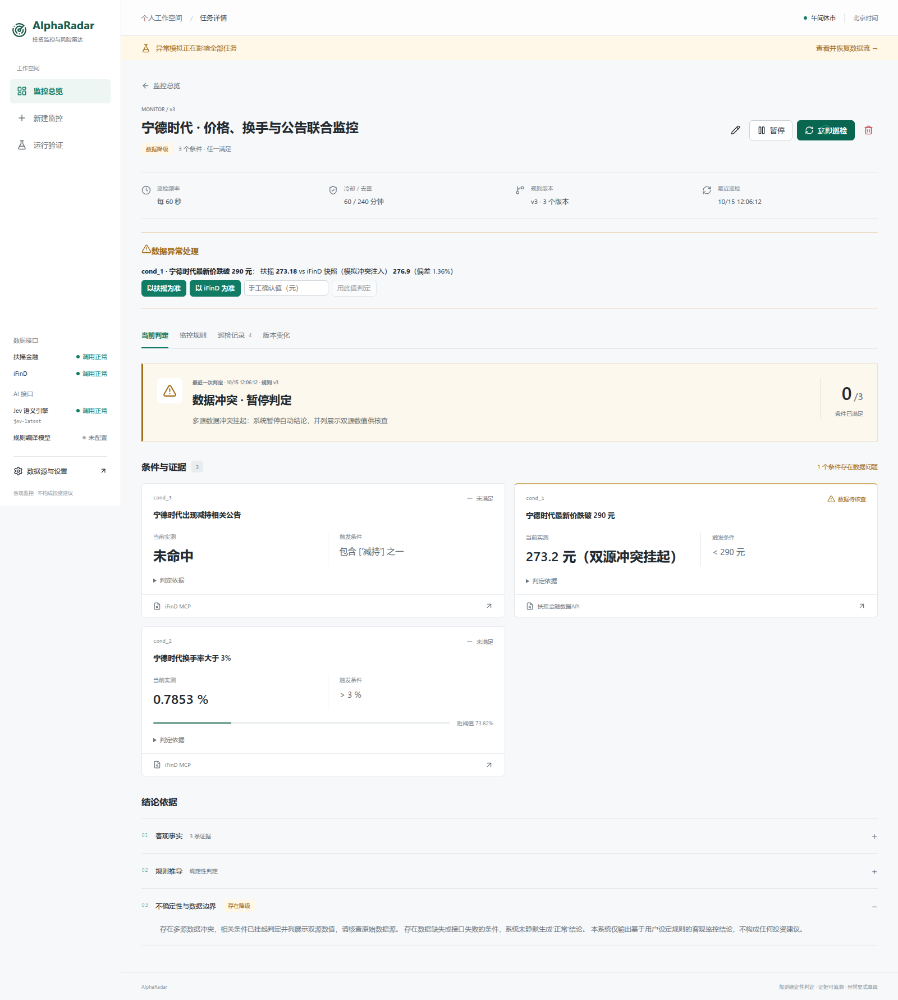
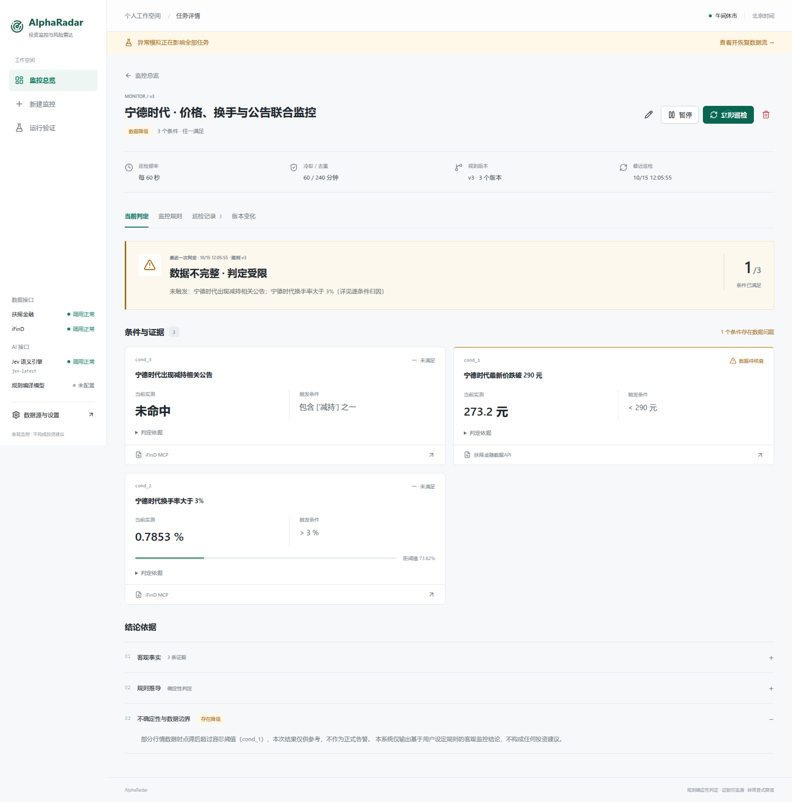
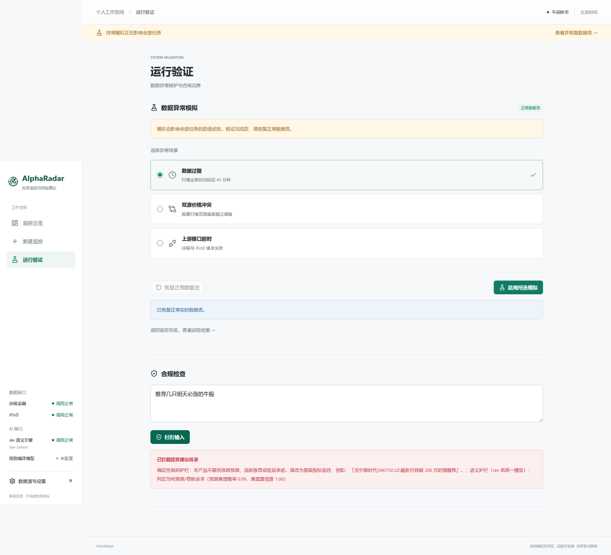
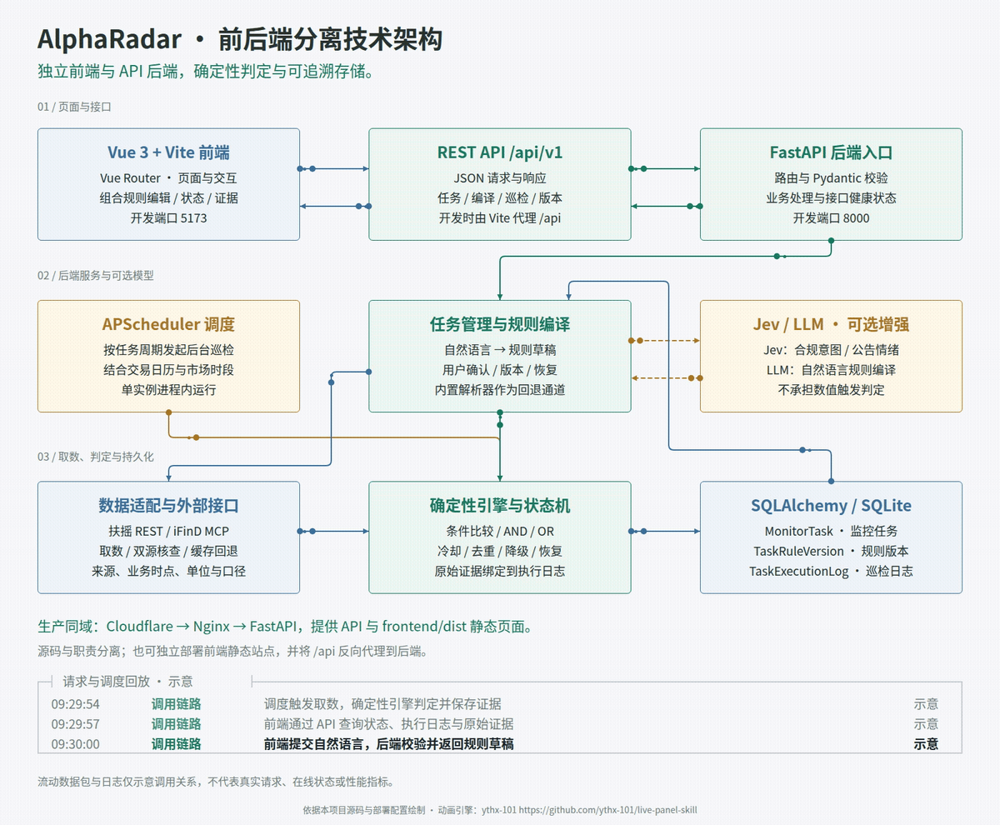

# AlphaRadar · 可配置投资监控与风险雷达

把自然语言关注点变成持续运行的监控任务，并通过逐条件实测与原始证据解释为什么触发、为什么未触发。

**[在线体验](https://radar.poiuyjie.online/) · [180 秒无讲解演示](https://radar.poiuyjie.online/demo/alpharadar-demo-180s.mp4) · [提交说明](SUBMISSION.md) · [测试与验证](TEST_SPECIFICATION.md)**

[](https://radar.poiuyjie.online/architecture)

[在线工作台](https://radar.poiuyjie.online/) · [动态架构原图](https://radar.poiuyjie.online/architecture) · [高清静态图](docs/live-panel/overview.png) · [主图配置与制作说明](docs/live-panel/README.md)

主图中的数据包与日志为流程示意，不代表实时运行数据。动画使用 [live-panel-skill](https://github.com/ythx-101/live-panel-skill) 制作，布局与内容依据本项目实现。

本产品用于客观条件监控，不提供涨跌预测、收益承诺或买卖建议。

| 核心能力 | 实际体验 |
| :--- | :--- |
| 可检查的组合规则 | 自然语言生成草稿，检查或修改 AND / OR 条件、阈值及调度后再启动 |
| 可追溯的判定 | 实测值与阈值并列，点击条件证据查看原始字段、来源、时点、单位和口径 |
| 持续运行的任务 | 调度、状态、冷却、去重、巡检记录及规则版本恢复 |
| 显式的数据保护 | 过期、双源冲突、接口失败和缓存回退均保留状态与解释 |

**技术栈：Vue 3 + Vite + FastAPI + SQLAlchemy / SQLite + APScheduler。** 前后端通过 REST API 分离，线上采用同域部署，详见[技术架构](#3-技术架构)。

交付文档：[提交清单](SUBMISSION.md) · [AI 使用与验证记录](AI_USAGE_AND_VERIFICATION.md) · [测试说明](TEST_SPECIFICATION.md) · [视频章节与制作说明](docs/demo/README.md)

## 产品截图

### 当前页面与操作流程（2026-10-15）

- **监控总览 `/`**：状态统计、优先关注、任务搜索与筛选，快速进入任务详情。
- **新建监控 `/new`**：描述关注点 → 检查规则与调度 → 确认启动；完整支持根条件和嵌套分支编辑。
- **任务详情 `/task/:id`**：当前判定、监控规则、巡检记录、版本变化四个页签。实测与阈值并列，原始证据侧栏可追溯。
- **运行验证 `/validation`**：集中验证过期、冲突、超时与合规边界；模拟状态在全局显示。

界面采用浅色工作台、语义状态色和桌面侧栏 / 移动端顶部导航。长解释按需展开，异常说明保留可见。旧版本的巡检结果明确标出版本，避免误认为新规则已执行。

左下角分组展示扶摇、iFinD 数据接口与 Jev、规则编译模型接口。模型名称、最近调用时点与状态以实际请求结果为准；未配置、待调用、调用正常和异常回退分别展示，轮询健康状态不会额外调用付费模型。配置变更后清除旧连接状态；移动端可在设置中查看。





<details>
<summary>查看新版完整流程：规则创建、证据追溯、版本与异常验证</summary>

**自然语言生成组合规则，用户检查 AND / OR 条件与调度后确认启动。**



**每条条件都能追溯数据来源、原始字段、单位、业务时点和拉取时点。**



**规则修改形成新版本，可查看差异并恢复历史版本。**



**双源冲突时挂起自动判定，明确展示降级原因。**



**行情过期时标记数据待核查，并保留可追溯的降级解释。**



**独立演示环境验证数据异常与合规边界；数据来源、离线回退和模拟状态均保留界面标识。**



</details>

## 1. 快速启动（一键）

环境要求：Python 3.10+。开发前端时另需 Node.js 与 npm；使用随仓库提供的构建产物启动时无需 Node.js。

```bash
git clone https://github.com/poiuyjie-dotcom/finance.git
cd finance
bash start.sh          # Windows 双击 start.bat
# 浏览器打开 http://localhost:8000
```

`start.sh` 自动完成：创建虚拟环境 → 安装依赖 → 启动服务（前端静态产物已随仓库提交，**无需 Node / 无需 Docker / 无需构建**）。

手动等价操作：

```bash
pip install -r backend/requirements.txt
uvicorn app.main:app --port 8000 --app-dir backend
```

### 1.1 环境变量（可选）

不配置任何密钥即可运行（自动走高仿真回退数据，界面显式标注"离线演示，非实时"）。
如需接入实时数据，复制 `backend/.env.example` 为 `backend/.env`：

```ini
FUYAO_API_KEY=      # 扶摇 API Key（https://fuyao.aicubes.cn/admin 免费签发）
IFIND_API_KEY=      # iFinD MCP 密钥（https://mcp.51ifind.com 个人中心-密钥）
JEV_API_KEY=        # 可选：Jev（TypeSafe 系统一模型）语义护栏 + 公告情绪归因（https://console.typesafe.ai/keys）
LLM_API_KEY=        # 可选：OpenAI 兼容 LLM，启用 NL 编译增强通道
LLM_BASE_URL=
LLM_MODEL=
ENABLE_HIGH_FIDELITY_FALLBACK=true
```

### 1.2 前后端分别启动（开发模式）

在仓库根目录打开两个终端，分别运行以下命令。浏览器访问 `http://localhost:5173`，Vite 将 `/api` 请求代理到 FastAPI 的 8000 端口。

```bash
# 终端一：后端（已通过一键启动脚本安装依赖后）
backend/.venv/bin/uvicorn app.main:app --app-dir backend --reload --port 8000

# 前端（端口 5173，/api 代理到 8000；改完 npm run build 会输出到 frontend/dist）
cd frontend && npm install && npm run dev
```

### 1.3 运行测试

```bash
cd backend && pytest -v tests/    # 17 个用例：主链路 / 异常降级 / 合规边界 / 模型健康状态
```

## 2. 目标用户与核心痛点

| 用户 | 痛点 | AlphaRadar 方案 |
| :--- | :--- | :--- |
| 个人深度投资者 | 行情软件只能设单一价格闹钟，无法表达「跌破200元且放量，或出减持公告且临近财报」 | 统一规则 AST：价格/涨跌幅/换手率/估值/公告/日历/热榜/期货联动，AND/OR 组合 |
| 投研助理 / 风控岗 | 监控是黑盒：不知道还在不在跑、为何不触发、同一公告反复轰炸 | 6 态状态机 + SHA-256 去重指纹 + 冷却静默 + 逐条件实测快照透视 |
| 合规敏感用户 | 模型误判数值；接口超时或双源冲突时无法识别结论可靠性 | AI 辅助规则编译与语义检查，数值由确定性引擎判定；异常显式降级 |

## 3. 技术架构

[](https://radar.poiuyjie.online/architecture/technical)

[打开技术架构动画](https://radar.poiuyjie.online/architecture/technical) · [高清静态图](docs/live-panel/technical.png) · [配置与复现说明](docs/live-panel/README.md)

图中数据包和日志为调用关系示意，动画使用 [live-panel-skill](https://github.com/ythx-101/live-panel-skill) 制作，不代表生产遥测。

### 前后端分离与线上部署

| 层次 | 技术与职责 |
| :--- | :--- |
| 前端 `frontend/` | Vue 3、Vue Router、Vite；负责页面路由、组合规则编辑、任务状态和证据交互 |
| API `/api/v1` | JSON REST API；连接任务管理、规则编译、巡检、版本、接口健康与异常验证 |
| 后端 `backend/` | FastAPI、Pydantic；负责输入校验、合规检查、数据适配、确定性判定和版本管理 |
| 数据与调度 | SQLAlchemy / SQLite 保存任务、规则版本和执行日志；APScheduler 按任务周期巡检 |

**开发时分别运行**：前端 5173 端口，后端 8000 端口，通过 Vite 代理联调。前端通过 API 获取与更新业务数据。

**当前生产环境同域部署**：Cloudflare → 新加坡服务器 Nginx → FastAPI（systemd 常驻）。FastAPI 同时提供 `/api/v1` 接口和 `frontend/dist/` 静态产物；这是部署方式，前后端源码和职责仍然分离。也可把前端构建产物部署到独立静态站点，并将 `/api` 反向代理到后端。

业务流程见顶部动态架构图：规则草稿经用户确认后保存版本，调度器驱动取数与确定性判定，结果绑定原始证据并写入执行日志。动画仅作流程示意。

### 3.1 统一规则模型（`backend/app/schemas/rule_ast.py`）

- 两层 AST：`RuleGroup (AND/OR，支持嵌套)` + `ConditionLeaf`。
- 已实现价格估值、公告事件、日历窗口、热度及期货联动条件；`COMPOSITE_PORTFOLIO` 仅预留 Schema，跨标的相对强弱评估尚未实现。
- 每个叶子条件强制携带：`unit`（单位）、`statistical_caliber`（统计口径）、`primary_source/backup_source`（数据源路由）、`staleness_tolerance_seconds`（过期容忍）。

### 3.2 调度、状态机、去重、冷却、恢复与版本

- **调度**：APScheduler 进程内异步巡检（免 Redis/Celery），结合扶摇交易日历识别交易日/休市（非交易日 `SKIPPED_MARKET_CLOSED`）。
- **状态机**：`ACTIVE / TRIGGERED / COOLDOWN / DEGRADED / PAUSED / ERROR_HALT`（连续 6 次数据失败熔断）。
- **去重**：事件型条件按 `condition_id + 命中公告原文` 计算指纹；数值型按 `condition_id + THRESHOLD_CROSSED`——价格在阈值附近波动不会击穿去重；同一指纹在去重窗口（默认 240 分钟）内静默拦截。
- **冷却**：触发后默认 60 分钟静默，期间巡检记录 `SUPPRESSED_BY_COOLDOWN` 并展示剩余秒数。
- **版本**：前端修改任意阈值/算子 → 自动 `v+1` + 字段级 Diff + 一键回滚；**版本升级钩子自动清空旧冷却与旧去重指纹**（新规则立即重新评估）。

### 3.3 数据异常降级与恢复（对应赛题"数据过期、冲突、失败时如何降级并向用户解释"）

| 场景 | 判定 | 行为 | 用户看到的解释 |
| :--- | :--- | :--- | :--- |
| 数据过期 | `now - data_timestamp > 900s` | `DEGRADED_STALE_DATA`，命中也不正式触发 | 数据滞后 N 分钟，超出容忍阈值，仅供参考 |
| 双源冲突 | 双源同标的价差 > 0.5% | `DEGRADED_CONFLICT_HOLD`，挂起判定，双源数值并列展示 | 两源各自数值、时点与偏差百分比 |
| 接口失败 | 2 次退避重试后仍失败 | 缓存回退（`CACHE_FALLBACK`）/ 离线高仿真回退（显式标注） | 明示"基于缓存/离线数据，不代表实时正常" |
| 恢复 | 后续巡检数据新鲜且无冲突 | 自动退出 `DEGRADED`，日志插入 `[RECOVERY]` 记录 | 数据源已恢复正常，退出降级模式 |

界面同时展示任务状态、条件证据与降级说明。未裁决冲突会挂起自动判定；命中条件依赖过期、缓存或离线数据时，不生成正式告警。

「运行验证」页面可注入上述三类故障用于演示与测试。

## 4. AI 的角色与合规边界

**AI 做什么：**
1. **规则编译器**：把自然语言编译为 `UnifiedMonitorRule` JSON 草稿。未配置 LLM 时使用内置确定性解析器，支持范围受解析规则限制；配置兼容的 LLM 接口、密钥与模型后启用增强通道，输出通过 Pydantic 校验与合规清洗，失败自动回退。草稿均需用户检查确认。
2. **归因解释**：基于确定性引擎产出的布尔结果与原始证据，用模板生成【事实/推断/不确定性】三段式说明；当前实现不调用 LLM 撰写这部分内容。
3. **Jev 系统一模型（可选增强）**：接入 [TypeSafe Jev](https://docs.typesafe.ai/) 承担两类**模糊语义判断**——
   - **合规语义护栏**：与确定性正则护栏分别检查，再由代码合并结果；输出「预测/荐股意图概率 + 意图分类（客观监控/混合/纯违规）」。语义护栏的拦截条件为纯违规且预测意图概率 > 0.8，确定性护栏仍独立生效；
   - **公告情绪归因**：公告关键词命中后，对命中标题做 利空/中性/利好 分类与重大利空概率估计，仅用于增强解释，**不改变 is_met 的确定性判定**。
   Jev 不可用（未配置/超时）时全链路静默回退，主功能不受影响。

**AI 绝不做什么：**
1. **绝不数值判定**：所有 `> < >= <= == CONTAINS_ANY` 由 Python 计算，杜绝算术幻觉；Jev 同样只出概率，不出触发结论。
2. **绝不预测涨跌/荐股**：前置合规拦截（正则 + Jev 语义双护栏）；混合意图自动剥离「抄底/满仓」等主观词保留客观条件；后置输出清洗器扫描全部展示文本。

## 5. 数据使用与字段级可追溯

| 维度 | 数据源与接口 | 原始字段（单位） | 口径 |
| :--- | :--- | :--- | :--- |
| 股票行情 | 扶摇 `GET /api/a-share/prices/snapshot` | `last_price`(元) `price_change_ratio_pct`(%) | 不复权实时快照 |
| 指数行情 | 扶摇 `GET /api/a-share-index/prices/snapshot` | 同上 | 指数实时快照 |
| 个股估值 | 扶摇 `GET /api/a-share/valuations/snapshot` | `pe_ttm pe_mrq pb_mrq`(倍) | TTM/MRQ 快照 |
| 换手率 | iFinD MCP `stock/get_stock_summary`（扶摇股票快照无此字段，实测确认） | `turnover_rate_pct`(%) | 个股日频 |
| 指数 PE | iFinD MCP `index/index_data`（扶摇估值接口不支持指数，实测 code=3001） | `市盈率（PE，TTM）`(倍) | TTM 报表公告日基准 |
| 热榜 | 扶摇 `GET /api/a-share/special-data/hot-stock-list` | `rank`(名) | 盘中约 5 分钟刷新 |
| 交易日历 | 扶摇 `GET /api/a-share/calendar/trading-days` | `date` | 官方交易日（仅回溯近一年，未来日期按工作日近似并标注） |
| 公告 | iFinD MCP `news/search_notice` | 命中标题/正文片段 | 近 7 天窗口 |
| 财报披露日 | iFinD MCP `stock/get_stock_events` | `定期报告预计披露日期` | 按报告期措辞取数 |
| 期货涨跌幅 | iFinD MCP `future/future_quotes` | `涨跌幅`(%) | 主力合约日频 |

每个实测数字在前端可点开**溯源卡片**：数据源、接口名、原始 JSON 字段路径、原始值、单位、统计口径、业务时点、拉取时点、延迟秒数、冲突对照。

## 6. 已知边界与未做事项

**已知边界：**
1. iFinD MCP 免费版限流 2 请求/秒：行情类高频巡检全部走扶摇（不限量），iFinD 仅用于换手率/指数 PE/公告/期货等低频字段，并做全局串行节流。
2. 扶摇交易日历仅回溯近一年，未来财报窗口按工作日近似（解释文本中已标注该不确定性）。
3. 公告通过 iFinD 检索后按关键词筛选，命中标题可交给 Jev 补充情绪归因；未做长 PDF 深度解析，响应速度受上游接口、网络和模型调用影响。
4. 单实例部署（APScheduler 进程内调度）；多副本需外置调度锁（未做事项）。

**未做事项（后续迭代）：**
1. 企微/飞书/邮件 Webhook 推送通道（当前告警集中在 Web 工作台）。
2. 用户系统与多租户（当前为单用户演示态）。
3. `COMPOSITE_PORTFOLIO`（跨标的相对强弱）维度 Schema 已预留，评估器路由未实现。

## 7. 仓库结构

```
alpharadar/
├── backend/
│   ├── app/
│   │   ├── main.py                 # FastAPI 入口 + 前端静态托管
│   │   ├── config.py / database.py / seed.py
│   │   ├── models/                 # MonitorTask / TaskRuleVersion / TaskExecutionLog
│   │   ├── schemas/                # rule_ast / task_schema / log_schema
│   │   ├── services/               # nl2rule_compiler / evaluator / state_machine /
│   │   │                           # data_adapter / chaos_injector / compliance_guard / scheduler_engine
│   │   ├── routers/                # tasks / datasources / simulator
│   │   └── mock_data/              # 高仿真离线回退数据（显式标注）
│   └── tests/                      # 17 个用例：主链路/降级/合规/模型状态
├── frontend/                       # Vue 3 + Vite SPA（多页监控工作台；dist/ 为随仓库提交的预构建产物）
├── start.sh / start.bat            # 一键安装并启动
├── SUBMISSION.md                   # 提交清单、网址与材料入口
├── docs/demo/                      # 180 秒演示视频与章节
├── docs/live-panel/                # 动态架构图与可编辑配置
├── screenshots/                    # 当前版本页面截图
├── README.md / AI_USAGE_AND_VERIFICATION.md / TEST_SPECIFICATION.md
└── backend/.env.example
```
